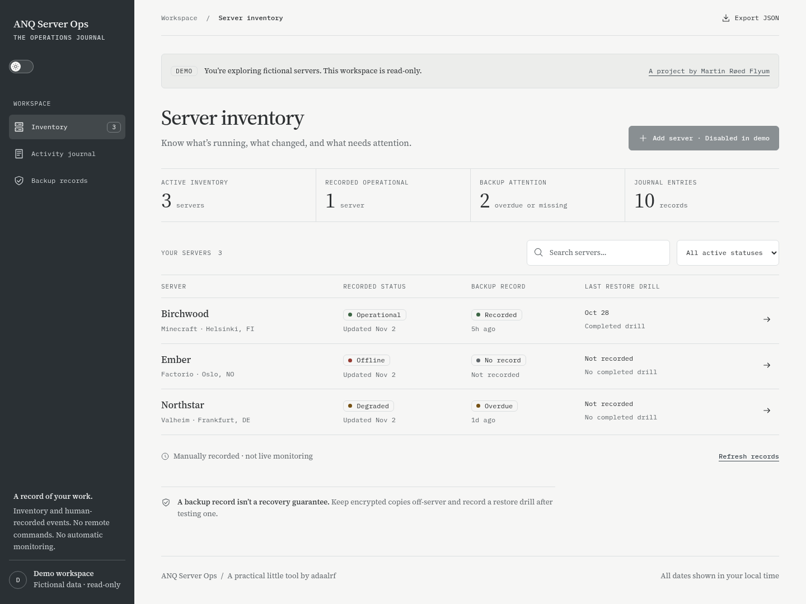

# ANQ Server Ops

[](https://github.com/adaalrf/anq-server-ops/actions/workflows/check.yml)

A small journal for keeping track of servers and what's been done to them.

[Explore the demo](https://ops.demo.adaalrf.dev) · [Read the case study](https://adaalrf.dev/work/anq-server-ops/)



The demo is read-only and holds fictional servers.

## Why it exists

Too many services on too many cloud platforms had outgrown an Excel sheet. A sheet can
list what exists, but it's a poor place to record what happened to each server, and
when.

Replacing it raised a more useful question: what does a record actually prove? A
planned backup isn't a finished one. A finished backup isn't a tested restore. And a
note saying a server was fine yesterday doesn't mean it's fine now. A monitoring
dashboard answers a different question, so this keeps track of what was actually
done instead.

## What it does

- Keeps an inventory of servers to search, edit and archive.
- Records maintenance, incidents, backups and restore drills, with when they happened.
- Shows which servers have overdue or missing backups, against a target for each.
- Keeps restore drills apart from backups, and doesn't let a planned or failed backup
  count as a recent one.
- Keeps an archived server's history, and corrects mistakes with a new entry.
- Exports the inventory and journal as JSON.

## How it works

A status here is someone's latest recorded assessment, never a live health check, and
the interface keeps it that way. Only past, completed backups count towards freshness,
and restore drills have their own timestamp.

Recording work from a server's page fixes the entry to that server, while starting
from the journal asks you to choose one, so an entry always has a clear target. As in
the other ANQ apps, each record has a version number, so a stale tab gets a conflict
rather than overwriting newer work.

## Try it yourself

You'll need Linux, Node.js 24 or newer, npm and rootless Podman. Then, from this
directory:

```sh
npm ci
npm run setup:local
npm run dev
```

Open <http://localhost:5173> and sign in as `owner`. Setup starts a local PostgreSQL
database with a fictional inventory, and your generated password is in
`.local/owner-credentials.json`. Press Ctrl-C to stop; your data stays, and running
setup again keeps it.

## Under the hood

Built with React, TypeScript, Fastify and PostgreSQL. The interface and the API share
one origin.

| Worth reading                                                | Why                                        |
| ------------------------------------------------------------ | ------------------------------------------ |
| [`Inventory.tsx`](src/client/pages/Inventory.tsx)            | Status and recovery evidence together      |
| [`model.ts`](src/shared/model.ts)                            | When a backup counts as missing or overdue |
| [`RecordDialog.tsx`](src/client/components/RecordDialog.tsx) | Entries tied to one explicit server        |
| [`browser.ts`](tests/browser.ts)                             | Forms, recovery, filters and deep links    |

## What it leaves out

It only records what people tell it. It doesn't probe hosts, run commands, check backup
repositories, send notifications or control game servers. It's built for a small fleet
with one owner, and there's no JSON import.

## Going further

- [Architecture](docs/ARCHITECTURE.md): domain rules and the security boundary
- [Deployment](docs/DEPLOYMENT.md): owner mode, the demo, backups and recovery
- [Contributing](CONTRIBUTING.md): where things live and how to run the tests
- [Design](DESIGN.md): the visual rules

The [first public commit](https://github.com/adaalrf/anq-server-ops/commit/daca5cd) is
a squashed snapshot of earlier work; changes since then are recorded one by one.
