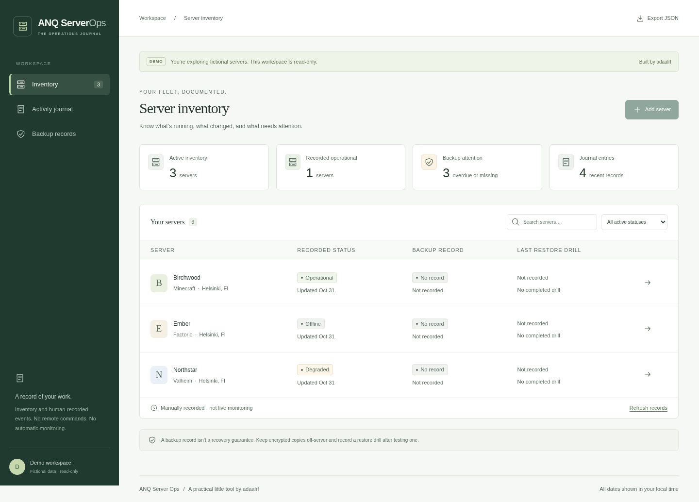

# ANQ Server Ops

[](https://github.com/adaalrf/anq-server-ops/actions/workflows/check.yml)

A single-owner operations journal built with React, TypeScript, Fastify and
PostgreSQL. Keep a small server inventory, record maintenance and incidents,
and distinguish a completed backup from a tested restore.

[Try the read-only demo](https://ops.demo.adaalrf.dev) with fictional records.



Navigation keeps the desktop sidebar and uses a labelled, keyboard-accessible mobile
menu with a return-to-top control. Colours follow the device’s light/dark preference.
The browser suite checks both themes and mobile navigation with fictional data.

## Run locally

Requires Linux, Node.js 24+, npm and rootless Podman:

```sh
npm ci
npm run setup:local
npm run dev
```

Open http://localhost:5173 and sign in as `owner`. Read the generated password
privately in `.local/owner-credentials.json`. Setup starts PostgreSQL 17 with a
persistent volume and fictional inventory. Repeating setup preserves records and
credentials. Ctrl-C stops the API and Vite, leaving the database intact.

## Use it

- Create, search, edit and archive servers; archived records retain their history.
- Record maintenance, incidents, backups and restore drills with event times.
- Review overdue/missing backups against each server's interval target.
- Keep restore evidence separate: planned or failed backups do not reset freshness.
- Export the complete inventory and journal as JSON.

Record work from a server's details or select an active server in the journal.
Stale edits return a conflict; reload and review before reapplying changes.
Correct journal mistakes with a new entry. View and server links survive refresh
and Back/Forward. The journal has filters and 25 entries per page.

## Configuration and limits

`.env.example` describes manual configuration. Owner mode uses
`DEMO_MODE=false`, `OWNER_USERNAME`, `OWNER_PASSWORD_HASH` and an exact
`APP_ORIGIN`. Generate a hash with `npm run --silent password`, passing the
password on stdin. HTTPS is required outside localhost. A demo exposes its entire
inventory and export; give it a separate database containing fictional records.

This app records human observations. It does not probe hosts, execute commands,
verify backup repositories, send notifications or control game servers. Inventory
is unpaginated and intended for a small fleet. Journal history is append-only
through the app, not tamper-proof against database administrators. Export has no
matching JSON import endpoint.

## Development and deployment

[Contributing](CONTRIBUTING.md) covers the source map, development commands and
isolated API/browser tests. [Design](docs/DESIGN.md) explains the domain rules and
authorization boundary. [Operations](docs/OPERATIONS.md) covers deployment and
recovery. Keep credentials private and never aim tests at production.
